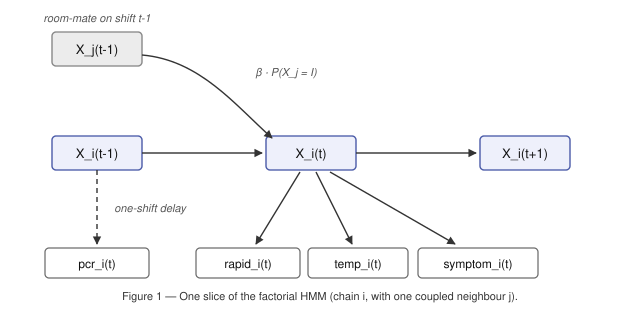

# outbreak-sentinel

An online screening policy for a facility under outbreak lockdown. Each shift the
system sees noisy, frequently-missing biosensor readings for everyone still on duty
and must decide, per person, whether to **clear** them for the shift or send them to
**quarantine** — a decision that cannot be undone.

The goal is to minimise total cost: clearing someone who is actually infectious is
expensive (they contaminate the facility), quarantining someone is cheap but
permanent, and the signals are weak enough that *when* to act matters as much as
*who* to act on.

## Approach

A **factorial hidden Markov model** — one SEIR chain per person, coupled through the
per-shift room-sharing graph.



Three things drive the design:

**The PCR assay runs one shift behind.** It is the sharpest sensor available and the
only one that separates *exposed* from *susceptible*, but only if it is aligned to the
state it actually measures. Modelled with the correct lag, `P(positive | I) = 0.968`
versus `0.885` under the naive same-shift alignment, and `P(positive | E) = 0.681`
versus `0.331`.

**Inference is structured mean-field.** The joint state space is 4⁶⁰, so exact
inference is impossible. But given the other chains' marginals, each chain is an
ordinary 4-state HMM and can be solved *exactly* by forward–backward; the chains are
then reconciled by iterating. The backward pass is essential and cannot be faked by
repeating the forward pass — within a chain, later evidence never travels backwards,
so iterated forward passes reproduce plain filtering to the digit.

**Quarantine is absorbing, so this is optimal stopping, not classification.** The
policy runs a one-step lookahead on the belief-state MDP, enumerating all 36 possible
next-shift sensor outcomes exactly rather than sampling. Two bounds prune the work so
only a handful of people per shift need the full computation.

## What actually mattered

Measured over 4 episodes × 40–80 missingness seeds; standard error ≈ 4–6.

| Component removed | Cost | Worth | Significant |
|---|---|---|---|
| **Contact-driven hazard** → flat marginal rate | 715.7 | **40** | yes, ~7 s.e. |
| One-step lookahead → "quarantine now vs never" | 690.0 | 13 | yes, ~3.4 s.e. |
| Backward pass → forward filtering only | 691.9 | 6.5 | no, ~1.2 s.e. |
| `I → R` recovery row → infectious forever | 681.5 | 6 | no |
| *(full model)* | **675.7** | — | — |

The contact model dominates — but not for the obvious reason. Its value is not
precise estimation of who *is* infectious; it is correct identification of who is at
**no risk**. 75% of susceptible person-shifts (1932/2558) had zero infectious
contacts, and *none* of them became infected. A flat infection rate charges those
people 2.81% of spurious risk, which both causes false quarantines and dilutes the
genuinely exposed.

## Where the remaining gap goes

Four independent diagnostics agree that little headroom is left, and that the limit
is sensor information rather than the algorithm:

- Swapping the inferred belief for the **true** health state, keeping the same
  decision rule, scores 387.8 against an oracle optimum of 385.3 — the decision rule
  is saturated.
- Giving the contact term the **true** infectious status scores 685.3, i.e. no better
  than the inferred `P(I)`. This upper-bounds any improvement to contact inference.
- Fitting separate transmission rates for labs and shared areas is not supported by
  the data (likelihood-ratio *p* = 0.19).
- Gradient boosting on the raw observations reaches AUC 0.9678 against this model's
  0.9719, and adding the raw observations to the model's belief adds nothing.

Cost is dominated by ~6.3 person-shifts per episode where a genuinely infectious
person reads `P(I) ≈ 0.03` — one strong signal cancelled by concurrent negatives.

## Results

| | Mean cost | Runtime |
|---|---|---|
| Held-out episodes | **627.5** | 66 ms/episode |
| Development episodes (in-sample) | 681.9 | 30 ms/episode |
| Leave-one-episode-out | 684.7 | — |
| *Never quarantine (baseline)* | 2070 | — |
| *Oracle policy (knows the truth)* | 385 | — |

The optimism gap between in-sample and leave-one-out is only 10.3, and no constant
was fitted to the missingness rate — the model transfers without retuning.

## Layout

```
agent.py         online policy; exposes get_action(observations)
parameter.json   learned model parameters, loaded at import
train.py         offline parameter estimation from labelled episodes
evaluate.py      batch scorer over many episodes × missingness seeds
docs/report.md   full technical write-up
docs/model.svg   model diagram
```

## Running it

```bash
python3 train.py                 # re-estimate parameters -> parameter.json
python3 evaluate.py --seeds 40   # batch score over all episodes
```

The labelled episode data is not included in this repository. `agent.py` and
`parameter.json` are self-contained and need no data at inference time; `train.py`
and `evaluate.py` expect `data1.csv` … `data4.csv` in the working directory.

A note on measurement: a single episode is far too noisy to tune against — the
per-episode standard deviation is 60–100, while the never-quarantine baseline ranges
from 1040 to 2720 across episodes. Differences smaller than about 15 points need 40+
seeds to resolve, which is what `evaluate.py` exists for.
