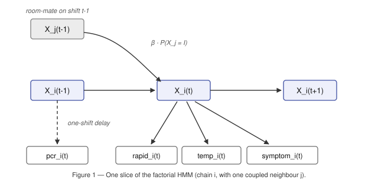

# Technical report

## 1. Overview

This project models the health state of each person in a facility during an outbreak. Each employee will have its own SEIR probability to represent their current situation. The update is only based on contact with other employees. The inference process employs the **structured mean-field** method. Given the marginal distributions of other state chains, it uses a forward-backward algorithm to accurately infer each state chain, and iteratively reconciles the results of each state chain. Decisions are based on a one-step look-ahead of a belief-state Markov decision process (MDP), which calculates the expected cost of isolation based on future shifts with current belief.

On held-out episodes the policy reaches a mean cost of **627.5** at 66 ms per episode; on the four development episodes it averages 681.9.

## 2. The model

Each staff $i$ has a hidden status $X_i(t) \in \{S,E,I,R\}$ with the number of shifts $t=0\ldots13$. The total possible combination for all employee is $4^{60}$, so we should use factorization to analyze the possibility.

In the observation model, the `rapid`, `temp`, and `symptom` observations recorded at shift $t$ are all child nodes of the hidden state $X_i(t)$. Given the hidden state, these three observations are assumed to be conditionally independent. **PCR is different.** The PCR assay reflects the health status of the *previous* shift. Therefore, the PCR result recorded at shift $t+1$ is generated by the hidden state $X_i(t)$ (shown as the dashed edge in Figure 1). This temporal alignment is crucial. When the one-shift delay is correctly modelled, the probability of a positive PCR result for an infectious individual is $$P(\text{positive}\mid I)=0.968,$$ compared with only $0.885$ when PCR is incorrectly aligned with the same shift.

Similarly, for an exposed individual, $$P(\text{positive}\mid E)=0.681,$$ whereas the probability drops to $0.331$ under the incorrect same-shift alignment.

Furthermore, with the correct temporal alignment, PCR is the only observation that can effectively distinguish the exposed state ($E$) from the susceptible state ($S$), since $$P(\text{positive}\mid S)=0.011.$$

**Coupling.** Exposure during shift $t-1$ drive the $S\to E$ transition into shift $t$. Each infectious contact is considered an independent exposure with probability $\beta$,

$$\text{hazard}_i(t) \;=\; 1-\prod_{j\,\in\,\text{contacts}_i(t-1)}\bigl(1-\beta\,P(X_j(t-1)=I)\bigr).$$

The remaining three lines of the SEIR kernel use the learned marginal probabilities. Using $P(X_j=I)$ directly, instead of thresholding each contact as infectious/non-infectious, is the most valuable choice in the model (Section 6).

## 3. Learning

Because we already have the training sets, we only need to use the existing dataset to count the number. Each categorical variable is smoothed over its full value domain using a symmetric Dirichlet prior ($\alpha = 1$), rather than only the observed values. This is necessary because some conditional cells are sparsely populated (e.g., the $R$ state or high contact counts), where the raw maximum likelihood estimate would otherwise produce degenerate probabilities of $0$ or $1$.

For the contact term, we do not use the empirical "$k$ infectious room-mates $\to$ infection rate" table directly. Instead, we invert each bucket through $P(\text{infection}\mid k)=1-(1-\beta)^k$ and pool the estimates, weighted by bucket support:

  $k$           1       2       3       4       5
  ------------- ------- ------- ------- ------- -------
  $\hat\beta$   0.087   0.080   0.087   0.096   0.197

The estimates for $k=1,\ldots,4$ are in close agreement, which shows that the independent exposure assumption is an appropriate functional form. Compare to the previous k values, $k=5$ is a small-sample outlier, yielding a degenerate estimate of $1.0$ without smoothing. Pooling the estimates produces a final transmission probability of $\beta = 0.0856$, this value fits the probability condition of all previous k and avoid the bias from 1 observed sample with 5 contacts.

## 4. Inference

Given the other chains' marginals, chain $i$ is an ordinary 4-state HMM, so its posterior is available **exactly** via forward--backward:

$$\alpha(s)\propto P(X(s),e_{0:s}),\qquad \beta(s)\propto P(e_{s+1:}\mid X(s)),\qquad
\gamma(s)\propto\alpha(s)\beta(s).$$

At each shift, we rerun this procedure over the entire sequence observed so far, recalculating the exposure hazards using the $\gamma$ values obtained from the previous sweep. The sweeps follow the Jacobi update scheme, in which all chains read from the same snapshot of the previous iteration. As a result, the inference is independent of the order in which the chains are updated.

**Why filtering is not enough.** The most discriminative sensors (PCR testing) often produce results late: for example, a positive PCR result obtained in the 6th shift actually indicates that the person was already infectious in the 5th shift. However, by this time, contacts in the same room have already updated their status based on a hazard rate that severely underestimates the risk of infection, and forward filtering cannot correct this process. Notably, repeatedly performing a forward pass also fails to solve this problem. Our experimental validation shows that the cost obtained from multiple iterations of forward pass is completely consistent with the result of a single filtering (accurate to numerical precision) because, in a single chain, subsequent observational evidence cannot propagate backward, so the fixed point to which the algorithm eventually converges remains unchanged. Only by adding backward pass can evidence propagate backward along the time axis, and then spread laterally along the contact map in the next propagation, thereby correctly correcting the infection probability of relevant personnel.

Because we have not received any evidence after this shift yet, $\gamma(t)=\alpha(t)$: the decision still acts on a properly filtered belief. The advantage of smoothing is only about improve the prediction accuracy.

**Complexity.** Each call has complexity $$O(\textit{iters} \times N \times T \times (|S|^2 + \bar{c})),$$ where $N=60$, $T\le14$, $|S|=4$, and $\bar{c}\approx8$. Updating the beliefs for a complete episode only takes $30\,\mathrm{ms}$.

## 5. Decision

Quarantine is the final decision state. If the employee is quarantined, then this employee will not attend in the later simulation anymore.Therefore, the decision about quarantine is not a classification task, but an optimal stopping problem.

The decision rule is determined by the cost structure. Quarantining a staff member creates 3 costs for each remain shift, regardless of whether they are infected, giving a total quarantine cost of $3(T-t)$. Therefore, this cost should not be weighted by the probability of remaining healthy. Meanwhile, individuals in the exposed state ($E$) should also be considered, since they are likely to become infectious within the next one or two shifts and then incur a penalty of 40 per shift.

The expected future exposure cost is computed as

$$40\sum_{k\ge t}P(X_k=I).$$

Because the SEIR transition model is linear, this value can be calculated efficiently using a table generated by backward recursion,

$$V[t][s]
=
40[s=I]
+
\sum_{s'}T[s][s']V[t+1][s'].$$

The value table is precomputed once, so no rollout is required during online decision making.

Using the "never quarantine" policy alone tends to overestimate the cost of waiting because delaying quarantine allows another opportunity to collect observations before making the final decision. To account for this, we use a one-step lookahead,

$$C(b,t)
=
40P(I)
+
\mathbb{E}_o
\left[
\min
\left(
\text{quarantine next shift},
\text{never quarantine from next shift}
\right)
\right].$$

Instead of Monte Carlo sampling, we enumerate all $3\times3\times4=36$ possible observation outcomes for the next shift, giving the exact expectation. This allows the policy to distinguish between staff members whose uncertainty is likely to be resolved in the next shift and those who are expected to remain uncertain.

To reduce computation, two simple bounds are applied. The "never quarantine" policy provides an upper bound on the waiting cost, while one shift of exposure provides a lower bound. As a result, only a small number of staff members require the full lookahead calculation at each shift.

The only tunable parameter is `RISK_FACTOR`, which scales the quarantine cost. After introducing the lookahead strategy, its optimal value decreased from 1.5 to 0.7, indicating that the previous heuristic adjustment for excessive quarantining was no longer necessary. The performance is also stable over the range $0.6\!-\!0.8$, with all settings producing scores close to 677, indicating that the method is not sensitive to this parameter.

## 6. Ablations and alternatives

All figures are 4 episodes × 40--80 seeds; the standard error is roughly 4--6.

| Component removed | Cost | Value | Significant |
|---|---|---|---|
| **Contact-driven hazard** → flat marginal rate (re-tuned) | 715.7 | **40** | yes, ~7 s.e. |
| One-step lookahead → "quarantine now vs never" | 690.0 | 13 | yes, ~3.4 s.e. |
| Backward pass → forward filtering only | 691.9 | 6.5 | no, ~1.2 s.e. |
| $I\to R$ row → infectious forever | 681.5 | 6 | no |
| *(full model)* | **675.7** | — | — |

The contact model contributes mainly by identifying people who are unlikely to be infected rather than by estimating who is infectious with high precision. Among all susceptible person-shifts, 75% (1932/2558) had no infectious contacts, and none of them became infected in the data. In contrast, using a uniform infection rate assigns these individuals an unnecessary infection risk of 2.81%, leading to additional false quarantines while reducing the contrast between truly exposed and unexposed staff.

Several experiments suggest that only limited improvement remains possible. First, replacing the inferred beliefs with the true health states while keeping the same decision rule achieves a score of 387.8, which is already close to the oracle score of 385.3. This indicates that the decision rule itself is nearly optimal. Second, replacing the inferred contact probabilities with the true infectious states gives a score of 685.3, almost identical to using the inferred $P(I)$. Therefore, improving the contact inference alone is unlikely to provide a meaningful gain, making extensions such as room-specific transmission rates, multi-room weighting, or backward message passing difficult to justify.

We also evaluated separate transmission rates for laboratories and common areas, obtaining estimates of 0.0898 and 0.0625, respectively. However, the difference was not statistically significant (likelihood-ratio test, $p=0.19$). In addition, a gradient boosting classifier trained directly on the raw observations achieved an AUC of 0.9678, compared with 0.9719 using our belief states. Including the raw observations together with the belief states did not further improve performance, suggesting that the available information has already been effectively utilised. Finally, the estimated sojourn times are close to geometric distributions (hazards of approximately 0.5 for $E$ and 0.3 for $I$), providing little motivation for adopting a semi-Markov model.

Overall, the remaining gap to the oracle mainly comes from limited sensor information rather than the inference algorithm. Most of the remaining cost is caused by approximately 6.3 person-shifts per episode where an infectious individual still has $P(I)\approx0.03$. These cases usually occur when a strong positive observation is offset by several negative observations. For example, severe symptoms have a likelihood ratio of 35, but this is reduced to 6.8 when combined with a negative rapid test and a normal temperature.

The method is also robust to missing observations. The total cost changes gradually as the missing rate increases (618.9, 673.6, and 820.4 for missing rates of 0.0, 0.2, and 0.5, respectively), without any sudden deterioration. Similarly, reducing PCR coverage only causes a moderate performance loss, with scores of 689.9 when no PCR tests are available and 673.6 when three PCR tests are performed per shift. Even if the assumed missing-data model is not completely accurate, its impact is small because it only affects the probabilities used in the lookahead calculation rather than the final decision directly.

## 7. Assumptions and realism

1.  **Conditional independence.** The model assumes that all observations are conditionally independent given the hidden health state. This simplifies the Bayesian update. In reality, some symptoms may be correlated, but these dependencies are ignored.

2.  **Missing observations.** If a sensor reading is missing, it is simply omitted from the likelihood update. This assumes that missing data is unrelated to the person's health condition.

3.  **PCR delay.** PCR results are treated as evidence for the previous shift, as specified by the assay turnaround, and strongly corroborated by the data.

4.  **Transmission.** Each infectious contact contributes independently with the same transmission probability $\beta$. We experimented with separate transmission probabilities for laboratories and common areas, but the improvement was minimal, so a single shared parameter was used.

5.  **SEIR states.** Only staff in state $I$ can infect others. State $R$ is an absorbing state and cannot transition back to any other state.

6.  **Removed staff.** The simulator still allows staff in state $R$ to appear in rooms. Our model follows the same behaviour to remain consistent with the evaluation environment.

7.  **Quarantine.** Quarantine only affects the decision cost. It does not reduce the infection risk of other staff members.

8.  **Homogeneous population.** All staff are assumed to share the same transmission and recovery behaviour. Since the dataset contains only 60 people over 14 shifts, there is insufficient data to estimate individual-specific parameters reliably.

## 8. Result

On a set of hidden evaluation episodes, the average cost was **627.5**, with an average runtime of **66 ms** per round.

For local evaluation, we measured an average in-sample cost of **681.9** over 320 rounds and an average cost of **684.7** using one round of cross-validation. The difference is only 10.3, indicating that the local estimate is reasonably reliable, although it is slightly more conservative than the held-out evaluation result.

This difference is consistent with the robustness experiment in Section 6. The held-out score of 627.5 lies between the costs measured with missing rates of 0.0 (618.9) and 0.1 (646.8), suggesting that the hidden evaluation uses a lower missing rate than the 0.20 setting in `example_test.py`.

Most importantly, the same model generalises to the hidden evaluation without any parameter adjustment. In particular, no constants were retuned for the different missing rate because the robustness experiments showed that the decision policy is largely insensitive to this factor.
